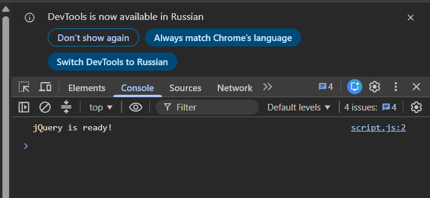
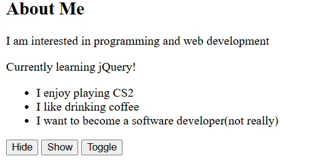
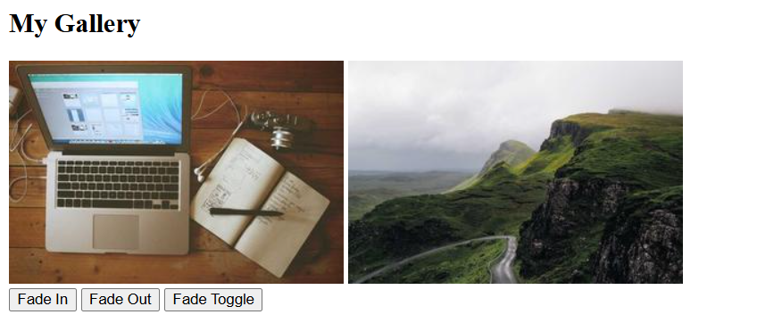
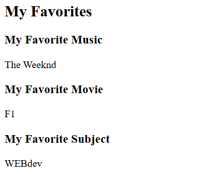
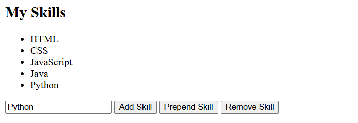
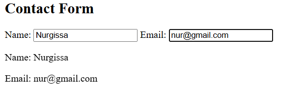
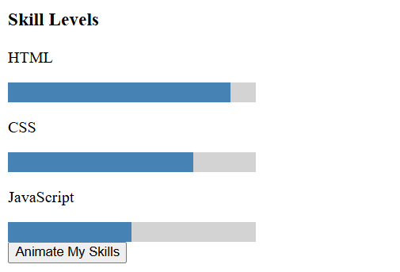

# Assignment 6 - jQuery

Name: Nurgissa Pernebay  
Group: SE-2539

## Task 0. Setup
Connected jQuery using a CDN and printed "jQuery is ready!" in the console.

## Task 1. Selectors & CSS
Created a portfolio introduction, changed text and styles using jQuery selectors, and added light and dark themes.

## Task 2. Visibility Methods
Added an About Me section with a status message and buttons to hide, show, and toggle it.

## Task 3. Fade Methods
Added two images with Fade In, Fade Out, and Fade Toggle buttons.

## Task 4. Slide Methods
Added three clickable headings with panels that open and close using slide effects.

## Task 5. Add & Remove Elements
Created a skills list and buttons to add, prepend, and remove skills. Empty input is not added.

## Task 6. Modifying Attributes
Added a social media link and a button that changes its destination.

## Task 7. Form Interaction
Created Name and Email inputs and displayed the entered text below the form.

## Task 8. Basic Animation
Created three skill bars and a button to animate their width and reset them to zero.

## Summary
I created a simple portfolio using HTML, CSS, and jQuery. I used selectors, effects, DOM manipulation, and animations to make the page interactive.
